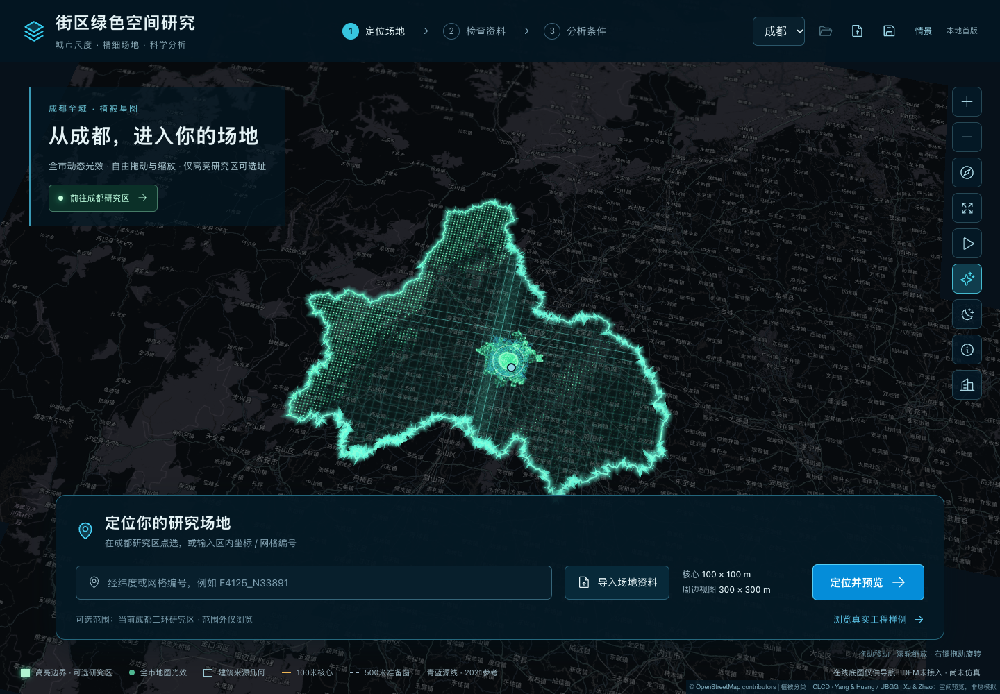

# 街区降温研究平台 · 团队协作原型

这是把现有高密度街区降温研究转为可浏览、可审阅、可保存工程的软件原型。本仓库供队友了解已有界面、检查资料与协议、共同确定下一步软件方案。当前拟面向政府规划、园林绿化和城市更新等业务讨论；**具体服务部门、使用任务、首版功能和交付流程仍需团队共同明确。**

本仓库从现有本地平台独立复制，保留原型功能、展示资料、六类证据登记和历史核验材料。目前提供可运行的资料展示与工程交接原型；模型在线服务仍待接入。此版本日期：2026-10-22。



原型界面预览，图中光点用于植被显示。

## 先看什么

- 只想看原型：直接打开[在线演示](https://xiaoman-0vo.github.io/urban-cooling-platform-demo/)，无需安装；希望本地运行时，按下文安装依赖并执行 `npm run dev`。
- 准备开发：先读“当前能做什么”“研究模块与边界”“团队协作”，再看 `src/App.jsx`、`src/project.js` 和相应证据模块。
- 想拿原始数据：查看[数据下载与校验说明](datasets/README.md)和[已发布的数据 Release](https://github.com/Xiaoman-0vo/urban-cooling-platform-demo/releases/tag/v0.1.0-collab-20261022)。运行前端已有展示资料不需要下载全部原始数据；在线预测还需要单独整理研究代码、权重和输入。
- 想复核证据：查看界面的来源/证据面板、`public/data/*-state.json`、`DATA_SOURCES.md` 与 `evidence/`。旧材料中的状态只对应其快照日期。

当前源码、展示资料及四个原始数据包均已公开发布；在线原型通过 GitHub Pages 提供。首次[云端检查与部署](https://github.com/Xiaoman-0vo/urban-cooling-platform-demo/actions/runs/39764595820)已通过。网页提供当前原型功能，尚未连接在线模型计算服务。

## 当前能做什么

| 层次 | 已有内容 | 使用边界 |
| --- | --- | --- |
| 地图与定位 | 成都、四川导航，植被显示光点，真实来源的建筑与道路展示，已有研究区内的坐标/网格定位与场地预览 | 全市地图用于导航；新选址受固定二环操作边界限制。显示光点、扫描线、光晕不代表降温效果、服务半径或测量结果。 |
| 资料审阅 | 内置示例场地、研究状态、试点准备、增补资料、来源准备、来源几何、条件来源登记及可用证据面板 | 准备、来源存在、合同验证通过和科研采用分别记录；不能由“成功打开”推定模型或规划结论有效。 |
| 场地与情景 | WGS84 GeoJSON 导入，图层与对象审阅，已有场景和条件草案的编辑与保存 | 用户导入或定位预览不自动获得研究准入、模型预测或可施工性。 |
| 工程交接 | 本地工程保存/恢复，JSON 与 ZIP 导出/重新打开；登记身份、空值与门控随工程保留 | 浏览器保存依赖当前浏览器与地址；重要工程请另存 JSON/ZIP。 |
| 研究应用 | 浏览已经整理的材料和部分既有研究证据 | 尚无网页端模型 HTTP 接口，不能把界面操作当成模型已运行。 |

**尚未完成：**在线温度预测、统一目标反推调用、跨模块联合计算、预算自动配置、自动可施工方案、自动 PDF 报告。实时社交媒体、实际遮阴验证、人体热舒适和真实使用收益也不是现成功能。Agent 接口仍待开发，今后应调用真实查询/计算工具并解释结果，不生成缺失的研究数值。

## 本地启动：macOS / Windows

先取得源码：在仓库首页点击 **Code → Download ZIP** 并解压；熟悉 Git 的队友也可以运行：

```text
git clone https://github.com/Xiaoman-0vo/urban-cooling-platform-demo.git
cd urban-cooling-platform-demo
```

需要 Node.js 20.19 及以上的 20.x，或 22.12 及以上版本，并带 npm。依赖版本已固定在 `package-lock.json`；推荐使用 Node.js 22，`.nvmrc` 提供 22.12.0 环境基线。

在终端或 Windows PowerShell 中进入本文件所在目录，然后依次运行：

```text
npm ci
npm run dev
```

打开 `http://127.0.0.1:5173/`。两个命令在 macOS 和 Windows 中相同；路径含中文或空格时，请在 `cd` 后给完整路径加引号。开发服务仅监听本机；关闭终端会结束该开发进程。

不要直接双击 `index.html`。应用使用 JavaScript 模块、数据请求、Web Worker 和浏览器存储，需要 HTTP 服务。请保留 `src/`、`public/`、`scripts/`、`worker/`、`config/` 与必要根文件，不能只拿一个 HTML。

原 Mac 的 `启动本地平台.command`、`停止本地平台.command` 和 `scripts/local-platform-service.mjs` 作为历史运行入口保留，使用 macOS launchd 与 4173 端口。**团队协作默认使用上面的 npm 入口。**本副本不要用旧启动器接管已有原平台的 4173 服务；Windows 不使用 `.command`。本副本预览端口另设为 4190。

### 构建与本地预览

```text
npm run build
npm run preview
```

打开 `http://127.0.0.1:4190/`。构建输出包括：

```text
dist/client/                 静态网页、展示资料与 MapLibre Worker
dist/server/index.js         保留的静态资源 Worker 适配器
dist/.openai/hosting.json    构建时从 config/sites-hosting.json 生成的适配配置
```

静态托管使用 `dist/client/`。Vite 的 `base` 为 `./`，展示数据和 MapLibre Worker 均按部署前缀取文件，适合仓库子路径；发布端仍须实际检查访问地址、资源和证据加载。当前静态原型通过 GitHub Pages 部署；`worker/` 保留既有 Sites 适配代码。根目录无需私有 `.openai` 配置，`config/sites-hosting.json` 仅含空资源绑定。构建产物和 `node_modules` 不进入源码提交。

## 目录结构

```text
src/                         React 界面、地图、工程与证据验证逻辑
public/data/                 已备好的 JSON / GeoJSON 展示资料和六类内嵌登记
public/maplibre/6.12.0/      本地 MapLibre Worker、共享模块与许可证
scripts/                     构建适配、历史数据登记、交接审计和本机运行工具
tests/                       软件测试、包内证据测试和原目录复核测试
tools/                       离线展示数据准备脚本及原环境依赖记录
worker/                      保留的静态资源服务适配器
config/                      可随仓库复制的非私有构建配置
evidence/                    历史软件核验、回读、截图、错误样例与受控代码快照
documentation/              原平台 README 与协作约定的历史副本
verification/               本协作副本的复制清单、路径审计与验证记录
datasets/                   原始数据索引、来源许可、下载工具与校验清单
.github/                    软件检查、Pages 发布、Issue 与 PR 模板
CONTRIBUTING.md             开发、提交与评审约定
DATA_SOURCES.md              原有展示来源说明
```

`evidence/` 中包括故意损坏的负例、过去的失败日志和修改前代码，它们用于复核拒绝行为及软件历史，不应替换当前 `src/`、当成可用输入，或当成当前版本测试结果。`documentation/` 与根部历史交付记录中的外链可能指向原研究项目，供追溯使用。

## 研究模块与边界

温度预测拟作为后续规划比较的共同底座，但目前研究内部 Python 入口尚未包装成前端可调用的 HTTP 服务。

| 模块 | 已有研究能力 | 接入前必须保留的区别 |
| --- | --- | --- |
| 02 宏观冻结预测与函数目标反推 | `proxy_v1` 使用 21 个数值指标、9 个原始状态，经冻结编码器形成 26 通道；100 m 节点以本格和八邻格组成一圈输入。已有内部推理入口及固定条件下的目标候选结果。 | 26 通道不是让用户手工填写的 26 个数。当前图、冻结编码器、权重、输入支持和适用状态须一起交付。目标反推的标准化指标距离 D 为无量纲，不是工程费用；既有 1℃候选不等于真实建成后降温。 |
| 03 增绿需求、土地负担与剩余空间 | 已有独立冻结模型条件下的最少新增绿色投影面积、土地负担及剩余空间等正式结果。 | 采用自己的变量、样本、目标与合法候选协议；面积 m²、比例和 D 含义不同，不能用 02 的 D 最优候选直接换算成面积最优或预算方案。 |
| 04 潜在冷机会与人口分配 | 已有 5/10/15 分钟潜在冷机会、冷资源与通行条件区分及人口位置比较结果。 | 模型人口和潜在机会不是实际到访、实际受益或人体热舒适。原有人口、道路、入口、资源资格与总体边界须随结果保留。 |

02、03、04 采用不同模型、分析总体和情景定义。**对象 ID、版本、目标、输入与输出合同对齐前，只能并列展示证据，不能默认联合计算或共同验证一个改造方案。**

宏观正式留出评价曾得到 MAE 1.1473℃、RMSE 1.4680℃、R² 0.4971（596 个最终留出对象、冻结版本的三成员平均预测）。这些指标描述对应样本的地表温度预测误差，不是任意新场地的误差保证、改造效果验证或行业最优声明。研究原始标签为 2020-07-19 约北京时间 11:39 的 Landsat 地表温度，不能写成实时气温、全天温度或热舒适。

### 模型服务另行整理的范围

本仓库没有替代完整研究代码库。开发在线接口至少还需单独整理：

1. 02 冻结推理代码、三成员权重、训练时的标准化/状态编码参数、正式图节点与边、输入清单及哈希、依赖环境与固定样例。已有内部 `evaluate` 是 Python 调用，不是 HTTP API。
2. 02 函数空间目标反推的调用入口、固定/可变条件、支持域检查和失败/无解返回合同。
3. 03 独立模型、面积目标与合法候选约束、逐格结果和字段解释；不能只移交一列“建议增绿面积”。
4. 04 现行冷资源、道路与接入、人口、时间阈值和逐位置/逐格结果；沿用自己的分母及无机会规则。
5. 接口端按需选用 FastAPI 等服务方式；PostGIS、Agent 编排等组件是否引入，按实际查询量和流程决定。当前前端 React 19.2、Vite 6.4、MapLibre 6.12 可以继续使用，无需先整体替换框架。

## 数据怎么取得

### 已随源码带入的资料

`public/` 已包含启动所需的展示副本，保留示例场地和全部原型证据登记：

- `research-state.json`、`preparation-state.json`、`supplement-state.json`；
- `source-preparation-state.json`、`source-geometry-state.json`、`conditional-source-state.json`；
- 既有 `research_snapshots/`、`preparation_snapshots/` 历史登记。

这些登记有内嵌来源字节和独立哈希校验；原快照日期、科学采用状态和准入边界保持原含义。本副本没有改包内 SHA，也没有把旧证据更新成新结论。研究状态登记只含解析索引和原身份声明的部分，不应把重新解析说成重新取得了缺失的原字节。

前端展示资料、原始数据、模型推理输入和正式研究代码是不同层次。下列已有原始数据已通过单独的 Release 资产分包交付；模型权重、全部研究代码和未取得的源产品不在本次交付范围。大栅格与原始压缩包不进入日常源码修改。

### 原始资料的时间与空间支撑

| 资料 | 已核实的支撑 | 用途与限制 |
| --- | --- | --- |
| UBGG 成都分类 | 3 m TIFF；成都源影像为 2020-07-27 至 28 日 | 地表类别中树木/灌木合类，草地/稀疏植被另类；不能任意拆成独立树种、树冠高度或原始照片。 |
| CMAB v7 建筑 | Shapefile 屋顶投影与估计 Height 等字段；成都精确观测日期未闭合 | 二维建筑来源与估计高度背景，不是实测三维模型。全国源期范围、文件名、发布时间均不能替代成都逐栋观测日。 |
| CNBH 2020 | 10 m 建筑高度估计 TIFF；2020 为目标年，使用跨年源资料并受 WSF2019 掩膜影响 | 补充高度背景，不能当成同期逐栋实测，也不能把所有空值视为无建筑。 |
| Landsat LST | 主标签场景为 2020-07-19；约北京时间 11:39；30 m 产品网格、约 100 m 原生热支撑 | 质量筛选后按面积汇总到 100 m 格。30 m 产品网格不代表独立的 30 m 热观测。地表温度不同于气温与热舒适。 |
| CLCD 2020 | 30 m 年度土地覆盖分类 | 全市导航植被光点的独立显示源，不用显示占比替换正式 G02，不扩大科研准入范围。 |
| SGVI 2023 结果包 | 成都已有绿视率结果点及相关 Shapefile；已核读点表 441806 条，WGS84 | 已有结果不等于持有原始街景照片或分割标注。`gvi1–4` 的具体季节映射、拍摄方向/日期和可靠街段匹配仍待核实。点数是成都产品总量，不是二环内数量。 |
| 人口 | WorldPop 2020 目标年、中国约束型 R2025A v1；原生 3 角秒（赤道附近名义 100 m），2025 年发布 | 原生像元人口估计经研究处理形成现有人口格与九个代表位置；不是实际到访、逐栋居住或真实受益人数。 |
| 道路与研究边界 | 2021 年初 OSM 道路源线和二环高架单向主线围合边界；网页另有导航边界 | 历史中心线不自动代表当前道路面宽、通行权或入口。全市/四川导航轮廓不等于可计算研究区。 |

正式二环操作围合区约 60.4185 km²；研究米制计算采用 EPSG:32648，网页 GeoJSON 展示采用 WGS84。任意城市或任意框选区域需要另行准备同口径指标、图邻域、质量状态和模型适用性判断，不能直接沿用成都冻结模型承诺有效结果。

### 已发布的原始数据 Release

发布标签 **`v0.1.0-collab-20261022`**：

[团队数据 Release 页面](https://github.com/Xiaoman-0vo/urban-cooling-platform-demo/releases/tag/v0.1.0-collab-20261022) · [逐包下载、来源与校验步骤](datasets/README.md)

四个 ZIP 已公开发布。发布平台返回的每个附件字节数和 SHA256 与本地清单一致；本地打包时已逐成员读回验证。队友下载后仍应自行校验：

仅想先了解数据，可下载约 77 KB 的 [00_Dataset_Documentation.zip](https://github.com/Xiaoman-0vo/urban-cooling-platform-demo/releases/download/v0.1.0-collab-20261022/00_Dataset_Documentation.zip)，其中包含数据清单、产品说明、许可记录和下载工具；它不包含四个大数据包。

| 附件名 | 主要内容 | 实际 ZIP 字节数 |
| --- | --- | ---: |
| `01_WorldPop2020_China.zip` | 全国 2020 人口源栅格，约束型 R2025A v1 | 855,466,230 |
| `02_CLCD2020_China.zip` | 全国 2020 土地覆盖源栅格及发布者分类表 | 756,021,034 |
| `03_Chengdu_Buildings_Greenness.zip` | CMAB 成都完整 5 组件、SGVI 成都 `cd/` 全 45 成员、CNBH 原始 X105Y31 瓦片、UBGG 成都 TIFF | 296,274,587 |
| `04_Landsat_OSM_Basemaps.zip` | 10 景现存 Landsat 温度 DN/QA 窗口、2 景红光/近红外 DN/QA 窗口、两期 OSM 局部完整 way 提取件、Natural Earth 原始 ZIP 与成都导航边界响应 | 26,948,673 |

四包合计 **1,934,710,524 字节（1.9347 GB，约 1.802 GiB）**；118 项源文件/成员合计 2,356,992,143 字节。全国人口和 CLCD 未裁剪，Landsat 为既有窗口而非完整卫星场景，OSM 路网也不是成都全市全覆盖。此包未增加新裁剪、重投影或模型计算。

四包先按包分目录解压，避免公共清单互相覆盖；再按 manifest 按需合并数据，保留各包元数据。Shapefile 的 `.shp/.shx/.dbf/.prj/.cpg` 必须同目录保留。下载后先核对 `SHA256SUMS.packages.txt`，再按 `manifest.csv/json` 和 `SHA256SUMS.files.txt` 检查文件；`data_products.json` 记录版本、坐标、年份及限制，`license_verification.json` 保留逐产品许可核验，`verification_report.json` 记录四包读回结果。原数据中含发布者加工或估计产品，不全部是第一手实测记录。

取得数据后建议放在自己的独立数据目录，按清单校验哈希，不覆盖本仓库 `public/data/`。已有展示资料不要求你复刻作者的 Mac 目录。若要重新生成展示数据或复核当前研究原件，需要另行取得相应源文件并显式配置自己的路径。

## 证据、路径和可移植性

本次保留完整来源证据和历史收据。记录中可能出现作者当时的 `/Users/...` 等绝对路径，它们说明当时文件来自哪里，**不是联网地址，也不是队友启动前端时必须存在的路径。** 为维持认证身份，没有批量替换原资料内容或重写包内哈希。来源文件存在不代表科学采用、物理求解或联合方案验证已经完成。

| 操作 | 是否需要外部研究目录 |
| --- | --- |
| `npm ci`、`npm run dev`、`npm run build`、`npm run preview` | 不需要；首次安装依赖需要访问 npm 源。 |
| 默认 `npm test` | 使用包内展示资料、证据和临时软件夹具；先执行构建。 |
| 历史原目录复核 `npm run test:research-source` | 需要。部分测试引用原项目 `共享接口/`、`平台产品设计/` 或历史下载文件。未配齐时失败不表示前端坏了。 |
| `tools/prepare_data.py`、导航/绿点准备、登记重建及历史下载审计脚本 | 属离线来源再生成/复核，需原项目、城市数据仓库和对应 GIS/Python 环境；不是启动步骤。当前部分脚本仍按原目录布局或旧下载路径工作，迁移前需补显式路径参数。 |

不要直接运行历史离线脚本来“修复打不开”，也不要为了通过测试把未知值补零、替换原哈希或升级科学门控。`tools/requirements-display.txt` 记录了当时基础 GIS 环境，绿点脚本另需 `rasterio`、`openpyxl`；它不是覆盖所有模型与再生成脚本的一键环境锁文件。

## 软件验证

从干净依赖安装开始：

```text
npm ci
npm run build
npm test
```

默认测试保留包内可独立运行的地图导航、证据状态、工程兼容与 Worker 检查，另有六类内嵌证据及全登记工程 JSON/ZIP 往返测试。包内核验不等于重新证明当前研究目录中的原件仍完全一致。Mac 运行工具的本机案例在其他系统按测试定义跳过；本次实际验证的操作系统与执行结果见 `verification/`，不把未实跑 Windows 写成已验证。

首次 GitHub 云端验收在 Ubuntu 24.04、Node.js 22.23.3 上完成：依赖安装和构建成功，76 项 npm 检查中 74 项通过、2 项 Mac 专用案例按定义跳过、0 项失败；8 项 Python 下载工具离线检查全部通过，Pages 部署成功。[查看运行记录](https://github.com/Xiaoman-0vo/urban-cooling-platform-demo/actions/runs/39764595820)。之后每次向 `main` 提交会重新检查和发布，PR 会先运行检查。下载工具离线检查可在根目录执行 `python3 -m unittest discover -s datasets -p 'test_download_data.py' -v`。

在线原型另经实际浏览器验收：首页、Worker 与展示资料加载成功，五类证据入口、工程保存/恢复、JSON 与 ZIP 导出/重开和刷新恢复均通过；48 个随源码提供的公开资源逐字节一致。[线上验收记录](verification/online-publication.json) 保留实际请求、交互、浏览器版本及一次未复现的控制台资源提示。[数据发布核查](datasets/publication-verification.json) 记录四包远端大小、GitHub SHA256 digest 和公开下载 HEAD 检查；没有为核查重复下载约 2 GB 正文。

`npm run test:research-source` 保留原十五文件测试入口，用于配齐相应原目录后的进一步复核。它包括源件字节比较，和默认自足软件检查的覆盖范围不同。

提交前还应实际打开网页，检查所改页面、数据加载与工程保存/恢复。改动展示来源、坐标、单位、准入范围或登记协议时，同时检查来源说明和对应的拒绝案例；普通界面修改不需要重跑科研模型。

## 团队怎么协作

1. 先在 Issue 写清一个具体问题：使用者、触发操作、期望结果、依赖资料、验收方式。业务方案尚未确认的内容先讨论，不能仅凭队友想法文档认定已获确认。
2. 从主分支建立短期功能分支，例如 `feat/evidence-panel`、`fix/project-import`。一次 PR 尽量只处理一个可核验目标。
3. PR 说明写明行为变化、测试、使用了哪版数据，以及仍未接通的部分。界面改动附截图；涉及数据或协议时给出版本及哈希变化。
4. 不提交 `node_modules/`、`dist/`、`.runtime/`、私钥、令牌或本机 `.env`。原始数据按 Release 清单管理；新增来源应说明发布者、许可、时间、空间支撑和处理过程。
5. 评审后合并，不直接覆盖他人工作。模型调用、原资料变更、数据准入和解释边界须由对应负责人核对；不要因更换框架或增加 Agent 自行改变研究口径。

详细流程见 [CONTRIBUTING.md](CONTRIBUTING.md)。仓库目前公开可读，队友可直接浏览、下载和 Fork；直接写入权限需要仓库所有者按各自 GitHub 用户名邀请。最终技术后端、赛题题目与团队职责仍待共同确定；当前已上线的是网页原型。

## 暂定路线与待共同决定的问题

**以下是供讨论的首版建议，还不是已确认的软件方案：**在一个既有研究片区内，围绕共同模型降温目标，比较不同街区的增绿需求与土地负担，形成带来源和限制的规划比较表。温度预测作底座，潜在冷机会与人口先作为并列证据。

可先讨论五步流程：选定既有片区 → 查看温度预测及现状证据 → 设置共同目标 → 比较增绿需求与土地负担 → 导出规划讨论记录。必须先对齐研究对象、模型版本和情景合同；“导出规划比较表/报告”和在线推理接口仍需实际开发，不是当前按钮已完成的能力。

开始开发前，优先共同明确：

- **谁使用、做什么决策：**具体部门与岗位，面对的是片区筛选、街区比较，还是具体改造方案审议？
- **首版对象与边界：**固定研究区、100 m 网格和规划街区怎样对应；开放哪些目标、条件和操作？
- **首版取舍：**先做既有结果浏览与比较，还是同时接入预测/目标反推；Agent 是否必要，报告需要哪些内容？
- **接口合同：**输入来自哪里、哪些字段可变、输出如何解释、遇到缺失/超出支持/无解如何返回；02/03/04怎样保持独立而可对照？

业务范围未明确前，先保留现有原型与证据，避免把尚未具备的数据、预算和设施条件包装成自动施工决策。
