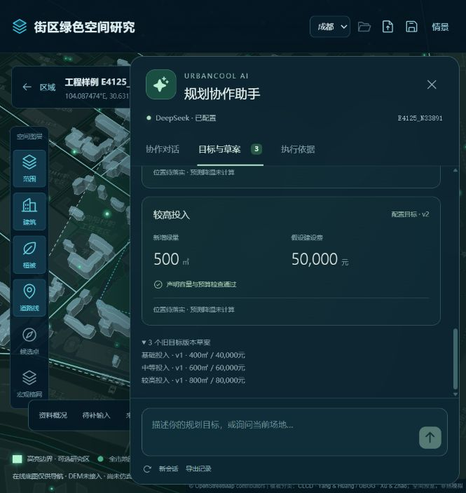

# 从零跑通 UrbanCool：地图、资料、Agent 与成果导出

这份教程记录 2026-10-24 的 DeepSeek 原型流程。使用支持注册、账户数据和 MCP 设置的版本时，参见[工作台启动与验收](工作台启动与验收.md)。

这次用一个具体任务走完整个系统：**查看成都样例街区的已有资料，给出10万元预算下的三档增绿配置，再把预算改成5万元，比较结果并导出记录。**

启动原型后，浏览器访问 <http://127.0.0.1:5173/>。

## 1. 启动系统

### 在 Windows 上启动

打开 Windows PowerShell，逐行运行：

```powershell
Set-Location 'C:\path\to\urban-cooling-platform-demo'
npm.cmd run dev:agent
```

使用 `npm.cmd` 可以避开 PowerShell 对 `npm.ps1` 脚本执行的限制，不用修改系统执行策略。

首次运行时先安装 Node.js 和依赖（`npm.cmd ci`），再在服务端设置 `DEEPSEEK_API_KEY`。

启动后，终端中应出现这两类信息，先后顺序可能不同：

```text
UrbanCool Agent: http://127.0.0.1:5181 (DeepSeek configured)
Local: http://127.0.0.1:5173/
```

含义是：5173提供网页，5181提供本地 Agent 后端。保持终端开着，接下来都在浏览器操作。浏览器能打开网页，还不等于 Agent 已可调用；后面会通过实际问题验证。

如果页面已经由另一个终端启动，可以直接使用。若启动提示5173或5181被占用，先查看后面的故障处理，不要连续重复启动。

### 打开网页

用 Chrome、Edge 或 Codex 浏览器打开：

<http://127.0.0.1:5173/>

首次通常看到成都区域地图，以及“定位你的研究场地”。如果打开后已经在某个场地，点击左上角“街区绿色空间研究”，回到区域页面。

本次使用本地网页。GitHub Pages 上的静态演示没有这次新增的本地 Agent 服务。

## 2. 进入已有真实资料的样例场地

在“定位你的研究场地”区域：

1. 点击 **浏览真实工程样例**。
2. 页面变为“确认位置与范围”，编号应为 **E4125_N33891**。
3. 点击 **进入场地**。

先用这个按钮进入，不要第一次就任意点选其他网格。样例有内置的详细资料，其他位置可能只有索引或几何预览。

进入后，左上角应显示“工程样例 E4125_N33891”，左侧有“范围、建筑、植被、道路线、候选点、宏观格网”等图层按钮。

可以依次体验：

- 点击“建筑”或“植被”，关闭后再打开，观察对应图层变化。
- 使用地图放大、缩小，以及“切换俯视与倾斜”按钮。
- 若地图一直转动，点击“暂停环视”。

地图上的光点、光晕和来源建筑用于空间展示；此时没有运行温度模拟。

## 3. 先看系统原有的资料功能

点击地图下方工具栏中的按钮，按下表浏览。小窗口内可能需要向下滚动；关闭详情用右上角的“×”。

| 点击入口 | 看什么 | 这一步帮助你判断什么 |
|---|---|---|
| 资料概况 | 场地身份、资料数量、核心及周边范围 | 正在分析哪个对象、有什么空间资料 |
| 待补输入 | 微观计算等方向尚缺的参数和证据 | 为什么有些计算还不能执行 |
| 来源与版本 | 数据来源、版本和时间口径 | 资料是否能放在同一个分析口径下使用 |
| 已有指标 | 已保存的几何代理、分类及候选诊断 | 哪些是已经存在的结果 |
| 分析条件 | 各研究方向的输入与接入状态 | 哪些功能可浏览、哪些仍待接通 |

“成果资料”“来源准备”“来源几何”还可以继续浏览团队整理的证据。本轮先熟悉内容即可，主流程不需要额外接纳资料或修改科研状态。

**完成标志：你能区分“已经保存的数据或结果”和“现在还没有运行的模型”。**

## 4. 打开 Agent，开始一段干净的体验

关闭资料详情，点击右下角 **AI 规划助手**。

面板顶部应显示：

```text
DeepSeek · 已配置
E4125_N33891
```

“已配置”表示后端检测到了密钥；实际能否调用，还要看第一条问题是否成功返回。

面板现有四个页签（2026-10-25新增多Agent框架）：

| 页签 | 用途 |
|---|---|
| 协作对话 | 输入自然语言问题、查看回答 |
| 协作任务 | 查看主任务、专业Agent、执行进度、阻塞和版本；完整演示见[多Agent框架说明](多Agent框架说明.md) |
| 目标与草案 | 查看用户给定的规划条件和程序生成的配置卡片 |
| 执行依据 | 查看实际工具名称、参数、返回结果和来源 |

如果看到上次演示的聊天，想保留就先点击底部“导出记录”，然后点击 **新会话**。新会话会清空当前面板的对话和目标，不会修改原有场地资料。

下面每条问题单独发送，等回答结束再继续。**同一轮体验不要再点“新会话”，也不要中途切换场地。**

## 5. 第一轮：让 Agent 解释现有资料

在“协作对话”复制发送：

```text
请梳理当前已载入场地的真实资料，说明现有绿量和数据限制。
```

正确结果应包含或能从执行依据查到：

- 场地：E4125_N33891。
- 网格面积：10000㎡。
- 现有分类绿色投影面积：1989㎡，占19.89%。
- 当前资料属于研究准备样例，温度预测服务尚未接通。

这里的1989㎡是来源分类得到的现状绿量，不是系统识别出的可新增面积。

回答结束后，点击 **执行依据**，展开“查询项目与能力”。你应该能看到真实工具返回、来源文件和基线哈希；部分记录还有“查看场地位置”按钮，可以联动地图。

这一步是在确认：Agent 实际读取了项目工具，而不只是泛泛聊城市绿化。自然语言表述可能变化，核对来源和字段更可靠。

回到“协作对话”，再发送：

```text
为什么当前场地还不能运行温度预测？请区分需要移交的模型文件和需要补齐的场地输入。
```

预期会提到冻结推理代码、权重、编码器、完整输入及接口，以及场地或微观分析所缺的相关数据。它不应为缺失数据编造温度。

## 6. 第二轮：给出条件，生成三档配置草案

复制发送：

```text
我给定的讨论假设是：预算10万元，候选面积800平方米，建设单价100元/平方米。保留建筑，生成三档配置目标，比较面积和费用，不计算温度。
```

这些是本次演示由你声明的规划条件。800㎡和100元/㎡没有经过真实地块、施工条件或报价核验。

回答结束后，点击 **目标与草案**。从新会话按本教程执行一次，通常会看到目标版本v1，条件应为：

| 条件 | 数值 |
|---|---:|
| 建设预算 | 100000元 |
| 声明候选面积 | 800㎡ |
| 假设建设单价 | 100元/㎡ |

向下滚动，三档程序结果应为：

| 草案 | 新增绿量配置 | 假设建设费 |
|---|---:|---:|
| 基础投入 | 400㎡ | 40000元 |
| 中等投入 | 600㎡ | 60000元 |
| 较高投入 | 800㎡ | 80000元 |

当前工具先取“声明容量”和“预算÷单价”的较小值，再按50%、75%、100%生成三档配置。所以这里最高使用800㎡、花费8万元，没有为了花满10万元而突破候选面积。

三张卡片应显示预算和声明容量检查通过，同时保留“位置待落实 · 预测降温未计算”。这是配置目标，还没有落实为地图上的植树位置，也没有得出哪一档降温最多。

到 **执行依据** 核对是否出现：

```text
登记目标草案
生成配置目标
比较面积与费用
```

**完成标志：对话触发了实际工具，目标、面积和费用已经进入结构化状态。**

## 7. 第三轮：只修改预算，观察版本和结果变化

回到“协作对话”，发送：

```text
把预算改成5万元，重新生成和比较。旧方案保留。
```

再打开 **目标与草案**。预期：

- 预算变成50000元；800㎡候选面积和100元/㎡单价继续沿用。
- 当前目标进入新版本；按上面的步骤通常是v2。
- 当前三档结果变为下表。

| 草案 | 新增绿量配置 | 假设建设费 |
|---|---:|---:|
| 基础投入 | 250㎡ | 25000元 |
| 中等投入 | 375㎡ | 37500元 |
| 较高投入 | 500㎡ | 50000元 |

这次预算最多支持500㎡，因此配置上限由原来的800㎡变为500㎡。

往下找到 **3个旧目标版本草案**，展开后应仍能看到原来的400/600/800㎡，以及4/6/8万元费用。

如果同一条条件反复提交，目标版本可能继续增加；核对“当前预算、当前结果、旧版保留”即可，不必要求版本号永远等于2。

下图来自这套原型的真实联调，显示较高投入草案及保留的旧版：



## 8. 第四轮：确认温度预测的接入边界

发送：

```text
请对当前较高投入草案尝试运行温度预测。如果服务未接通，请列出阻塞条件，保留未执行状态，不要估算降温数值。
```

预期回答是服务未接通，并说明模型或输入缺项。这一步目前**不会产生一个新的温度值**。

到 **执行依据** 展开“检查预测接入条件”，应看到类似：

```json
{
  "status": "not_connected",
  "execution_status": "not_run",
  "predicted_delta_lst_c": null
}
```

如果助手仅口头说明而没有出现这条工具记录，可以再发：“请调用检查预测接入条件工具，检查当前较高投入草案，并告诉我工具返回状态。”

这是在查看真实接入状态。现阶段没有接入温度科研模型，不能把“Agent 成功回答”当成“温度预测已完成”。

## 9. 第五轮：生成并下载讨论记录

发送：

```text
导出当前规划讨论记录，包含当前目标、三档草案、数据来源、假设和未接通项。
```

回答结束后，点击对话底部的 **下载最近的规划讨论记录**。

得到的是Markdown文件（`.md`），可以用编辑器打开。应包含当前5万元预算对应的草案、来源和版本，以及“预测未计算”的说明。文件内容由程序生成。

然后点击助手底部 **导出记录**，另存一个JSON文件。这份文件包含对话、目标、各版本草案和工具执行记录，方便排查问题或给队友看。

可以和已经生成过的[示例规划记录](../verification/Agent联调示例报告_2026-10-24.md)对照。文件ID、时间和对话措辞不必一致。

两种下载都按浏览器的下载设置保存，不一定落在项目目录。JSON目前用于保留和查看记录，界面还没有把这份 Agent JSON 重新导入为聊天的入口。

大模型的文字解释仍可能口误，关键面积和费用以“目标与草案”卡片、工具返回和程序报告交叉核对。

## 10. 保存并重新打开场地工程

这一步体验原有平台的工程交接，与 Agent 会话分别保存。

1. 关闭 Agent 面板。
2. 点击顶部软盘图标 **保存场地**，应出现已保存、读回核对的提示。
3. 打开 **资料概况**，点击详情底部 **导出交接**，浏览器应下载一个ZIP交接包。
4. 点击顶部 **重开交接包** 图标，选择刚下载的ZIP。
5. 等待完成，检查场地编号、图层、资料和来源状态是否仍在。

“保存场地”保存到当前浏览器的本地存储；换浏览器或访问地址时，不一定能读到同一份保存。ZIP文件适合单独备份和交接。

**场地ZIP不包含新 Agent 的完整对话。** 因此这次体验结束可以留下三个文件：

| 文件 | 用途 |
|---|---|
| 规划讨论记录 `.md` | 阅读当前比较结果 |
| Agent记录 `.json` | 保留对话、假设、目标版本与执行依据 |
| 场地交接包 `.zip` | 保留平台场地工程和原有资料登记 |

## 11. 正常结束与下次继续

网页可以直接关闭。在启动系统的 PowerShell 窗口按 **Ctrl+C**，停止本次由 `dev:agent` 启动的前后端。

下次仍用：

```powershell
Set-Location 'C:\path\to\urban-cooling-platform-demo'
npm.cmd run dev:agent
```

继续访问同一个地址、使用同一个浏览器，并载入同一个场地。只要浏览器会话标识和 `.runtime/agent/sessions/` 中的会话文件还在，打开助手可以尝试恢复此前会话。

“新会话”、换浏览器、换场地或清理浏览器存储都会影响自动找回。因此需要保留的讨论应主动导出。

## 常见问题

### 终端说找不到 package.json，或没有 dev:agent 命令

确认进入的是本次修改的目录：

```powershell
Set-Location 'C:\path\to\urban-cooling-platform-demo'
```

不是它的上级目录，也不是另一个重新下载的旧副本。

### 找不到 node / npm，或者提示缺少依赖

当前电脑已有Node和依赖；只有换机器或依赖确实缺失时才做首次安装步骤。

项目的Node要求见 `package.json`：20.19及以上的20.x，或22.12及以上版本。先确认：

```powershell
node --version
npm.cmd --version
```

确认版本可用后，在项目目录执行：

```powershell
npm.cmd ci
npm.cmd run dev:agent
```

`npm ci`会重新安装锁定依赖，不需要每次启动都执行。不要在已有开发服务正在运行时重新安装依赖。

### 5173或5181端口被占用

先访问 <http://127.0.0.1:5173/>。如果已经是这套系统，可以直接使用，不必再开一套。

如果之前只运行了前端 `npm run dev`，可以在另一个PowerShell窗口进入项目后，仅启动后端：

```powershell
npm.cmd run agent:server
```

如果想统一使用 `dev:agent`，先在原来属于本项目的终端按Ctrl+C，再启动它。不要结束不清楚用途的其他进程。

### 地图能打开，Agent 却提示服务未连接

确认访问的是本机5173，且后端5181正在运行；启动完整系统用 `npm.cmd run dev:agent`，不能只启动静态网页。

可以在浏览器打开下面的本地状态接口；这里只检查状态，不会发送模型问题：

<http://127.0.0.1:5181/api/agent/health>

正常时会看到 `status: ready`、`configured: true` 等字段。若服务启动后面板仍显示旧状态，关闭再打开助手。

### 提示密钥缺失、认证失败或余额不足

本系统读取的是 **DEEPSEEK_API_KEY**，不是 `OPENAI_API_KEY`。当前电脑已经存在前者。

如果PowerShell是设置环境变量之前打开的，可以在启动前重新读取用户环境变量；下面的命令不会显示密钥内容：

```powershell
$env:DEEPSEEK_API_KEY = [Environment]::GetEnvironmentVariable('DEEPSEEK_API_KEY', 'User')
npm.cmd run dev:agent
```

若是换电脑，可以参考 `.env.example` 新建 `.env.local`，在自己电脑的编辑器中填写 `DEEPSEEK_API_KEY` 后重启后端。密钥不要写进教程、聊天、前端代码或Git提交。

认证失败、余额不足和网络超时是不同问题，按面板提示处理。打开地图、查看已有记录不调用模型；发送问题和提交条件会调用DeepSeek API并产生相应费用。

### 地图底图空白或在线底图加载失败

点击地图控制里的 **只用本地图层**。已有本地来源图层仍可供浏览；这不会把数据缺项变成可用输入。

### 回答很慢、停在处理中

先等本轮结束，不要连续重复发送同一条条件。需要中断时点 **停止**，然后点底部刷新会话按钮，核对已经保存的工具结果。

停止等待前可能已经登记了条件或生成部分草案，因此重试前先看“目标与草案”，避免把重复提交误认为同一版本。

### 为什么没有温度图、具体植树点或自动施工方案

目前这一轮可跑通的是：**资料查询 → 明确用户条件 → 配置模板核算 → 预算修订与版本比较 → 讨论记录导出**。

冻结温度模型、干预到模型输入的转换、真实候选空间约束和空间优化仍待接入。地图中现有建筑/植被与三档草案不是同一件事；生成草案后没有新增植树点，是当前原型的实际能力边界。

技术结构与联调记录见[Agent原型使用与接入](Agent原型使用与接入.md)。
