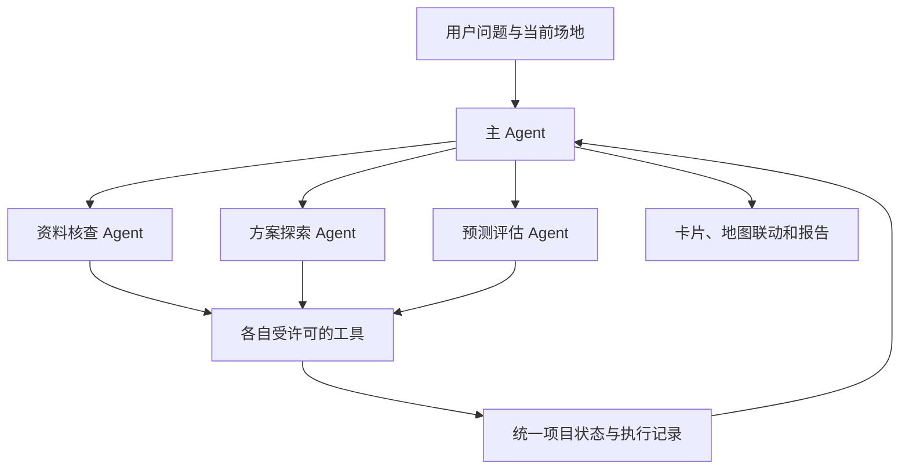

# UrbanCool 多 Agent 框架

版本：2026-10-25。已在本地原型上接入一个主 Agent、三个专业 Agent，继续共用 DeepSeek 官方 API。当前是按需、串行委派的协作框架，不是后台主动运行或并行任务集群。

## 立即试用

在项目目录运行：

```powershell
Set-Location 'C:\path\to\urban-cooling-platform-demo'
npm.cmd run dev:agent
```

打开 <http://127.0.0.1:5173/>，依次点击“浏览真实工程样例”→“进入场地”→“AI 规划助手”。需要保留已有聊天时先导出，再点“新会话”。

在欢迎页点击“体验多 Agent 协作”，或者发送：

```text
请让资料核查、方案探索和预测评估三个Agent协作：查询当前场地；按我给定的讨论假设，预算10万元，候选面积800平方米，建设单价100元/平方米，保留建筑，生成并比较三档配置草案，然后尝试温度预测；未接通则列出阻塞条件。
```

切换到“协作任务”页签，查看角色、主子任务、工具次数和状态。页面在请求执行期间每1.2秒读取本地进度；这些读取不会调用大模型。提出问题、委派专业 Agent 和提交规划条件会产生相应 API 调用。

同一会话继续发送：

```text
把预算改成5万元，候选面积和单价保持不变。请方案探索Agent重新生成并比较草案，旧版本保留；本轮不计算温度。
```

预期当前三档面积为250/375/500㎡、假设费用为25000/37500/50000元，旧草案保留。第二轮只需委派方案探索角色，不必为了展示团队而把全部角色重跑。

## 角色与权限

| 角色 | 可以执行 | 不授予的权限 |
|---|---|---|
| 主 Agent | 查询、登记本轮明确目标、委派、比较与生成报告 | 直接绕过方案角色生成草案；任意脚本或文件操作 |
| 资料核查 Agent | 查询项目、网格和缺项 | 修改目标、生成草案、继续委派 |
| 方案探索 Agent | 查询能力、生成固定模板、比较当前草案 | 修改预算、运行温度检查、继续委派 |
| 预测评估 Agent | 查询能力/缺项、比较草案、检查预测接入 | 修改目标、生成草案、继续委派 |

每个角色有独立的系统说明、消息上下文和工具列表。主 Agent 把子任务交给专业 Agent 后，专业 Agent 实际进行自己的模型—工具循环；不是只给同一个回答换角色名称。它们可共用同一个语言模型和服务端密钥，不需要分别训练模型。

后端执行前再次检查工具白名单。子任务文字不能扩大原始用户要求；目标更新必须逐字引用本轮用户原话，不能拿旧聊天中的10万元覆盖本轮明确修改的5万元。当前固定配置模板在同一目标版本重复调用会复用结果。

## 调用和状态



每轮用户请求建立一个主任务。子任务保存`run_id`、`parent_task_id`、角色、原始输入范围、输出范围、目标版本、数据SHA、语言模型名称、工具依据和结果。温度科研模型版本当前为空，不能用DeepSeek模型名代替。

| 状态 | 含义 |
|---|---|
| running | 已开始执行；工具和模型调用次数持续更新 |
| completed | 本角色已完成对应操作，不代表所有科研计算已完成 |
| completed_with_limits | 主任务完成汇总，但子任务仍有阻塞或失败 |
| needs_inputs | 缺少目标条件或当前可比较草案 |
| blocked | 模型未接通、旧草案或无正配置空间等阻塞 |
| failed | 模型请求失败、循环或调用额度耗尽等执行失败 |
| cancelled | 用户停止了本轮；已完成操作保留 |
| interrupted | 服务在任务结束前退出；重启后保留记录，不自动重试 |

状态由程序根据实际工具结果决定。模型摘要单独标记，不能把一段“已完成”文字当作计算成功。旧目标版本的方案、评估和主任务保留为旧版；数据核查绑定资料版本，不因预算变化而自动失效。

共享状态由同一后端按顺序写入，单个会话同一时刻只允许一轮写操作。子任务不是独立对外聊天接口。当前没有跨用户授权、分布式队列或多人协作数据库。

## 调用上限与恢复

- 每轮整个任务树最多16次模型请求、36次工具操作、6次专业委派。
- 主 Agent 最多6轮模型请求，每个专业 Agent 最多5轮，同时受全局上限约束。
- 最多一层委派，专业 Agent不能继续派生 Agent。
- 上游单次请求超时30秒，整轮默认180秒。
- 每次任务状态和工具操作后按序落盘到`.runtime/agent/sessions/`；页面只保留会话标识。
- 界面进度包含事件版本，较旧的轮询响应不会覆盖较新的结果。
- 服务重启时，尚未结束的任务标为`interrupted`。恢复旧版单 Agent 会话不要求预先存在任务字段。

「停止本轮」会向后端发送指定轮次的取消请求。页面等待后端确认，再显示停止结果。已保存的目标、草案和工具记录可以继续查看。

## 代码入口

| 文件 | 职责 |
|---|---|
| `server/agent-roles.mjs` | 四个角色、委派工具定义与每角色工具白名单 |
| `server/agent-runtime.mjs` | 通用模型/工具循环、权限拦截与全局调用计数 |
| `server/multi-agent.mjs` | 主从协调、独立子上下文、检查点和错误收束 |
| `server/agent-task-state.mjs` | 任务对象、结构化结果、旧版标识和中断恢复 |
| `server/agent-tools.mjs` | 复用查询、目标、配置模板、预测状态和报告工具 |
| `server/project-agent.mjs` | DeepSeek适配；原`runAgentTurn`入口兼容转入协作流程 |
| `server/agent-server.mjs` | 本地HTTP、统一落盘、进度读取和会话互斥 |
| `src/AgentTasks.jsx` | 团队、任务树、状态、版本与结果依据 |
| `src/AgentPanel.jsx` | 对话、进度轮询、草案、工具记录和导出 |
| `tests/multi-agent.test.mjs` | 委派、权限、版本、预算、故障、中断和HTTP进度检查 |

接口继续使用`GET /api/agent/health`、`POST /api/agent/sessions`、`GET /api/agent/sessions/{id}`和`POST /api/agent/chat`。health新增角色和调用上限；session新增tasks、active_run_id和event_version。浏览器使用Vite代理和既有BASE_URL。

任务及报告包含结构化产物和来源引用。会话接口随进度返回最近 40 条工具详情。对话和任务卡片上的「查看本轮依据」可以按轮读取完整工具记录，包括较早的任务。

## 当前计算边界与后续接入

方案探索角色现在调用的仍是面积/费用模板，不是空间布局优化器。预测角色调用的仍是`request_temperature_prediction`接入检查，明确返回`not_connected`、`not_run`和空预测值。增加角色不会产生缺失的模型能力。

宏观冻结温度预测的推理包与微观物理分析缺项要分别说明。`get_input_gaps`的`model_service_missing`列模型移交项，`site_items`来自微观/物理准备表，不能把材料热工和土壤等一律解释成宏观模型必填输入。

后续接入先完成一个真实冻结推理样例，再扩展现有工具：

1. 科研侧移交代码、权重、冻结编码器、完整输入、依赖和预期输出；增加模型版本及适用性检查。
2. 实现允许干预到完整模型输入的情景编译与空间检查。
3. 在相应协议下接入02或03求解器，替换模板的能力边界，不默认联合两者。
4. 再由方案Agent组织有预算上限的“候选—评价—修订”循环，验证同一批任务相对单Agent的实际收益。

本框架不替代真实施工条件、物理模拟和科研验证，也没有创建公网部署。

## 本次验收

2026-10-25完成两轮真实DeepSeek联调，共21次模型请求：首轮委派三个专业Agent，资料核查与配置草案生成完成，预测评估实际检查后标为阻塞；服务重启后第二轮只委派方案角色，将预算改为5万元并保留旧版。本轮明确不计算温度，工具记录中没有预测调用。

第二轮曾把沿用面积与单价重复带入目标更新，因本轮原话没有这些数字，被后端拒绝；主Agent随后改成仅更新预算并成功执行。拒绝及修正都保留在记录中，不会静默更新目标。

最终`npm run build`通过；`npm test`共109项，107项通过、2项按原定义跳过；其中33项Agent检查通过。Windows连续写快照的临时文件锁问题已补充有界重试，不删除已有快照；持续失败仍返回错误。

验收产物：[真实协作检查记录](../verification/multi-agent-live-checks-2026-10-25.json)、[软件检查摘要](../verification/multi-agent-software-checks-2026-10-25.json)、[示例报告](../verification/多Agent联调示例报告_2026-10-25.md)、[任务树截图](../verification/multi-agent-framework-2026-10-25.png)。模型文字摘要仍需核对工具原始结果，宏观模型移交与微观物理缺项应分别解释。
