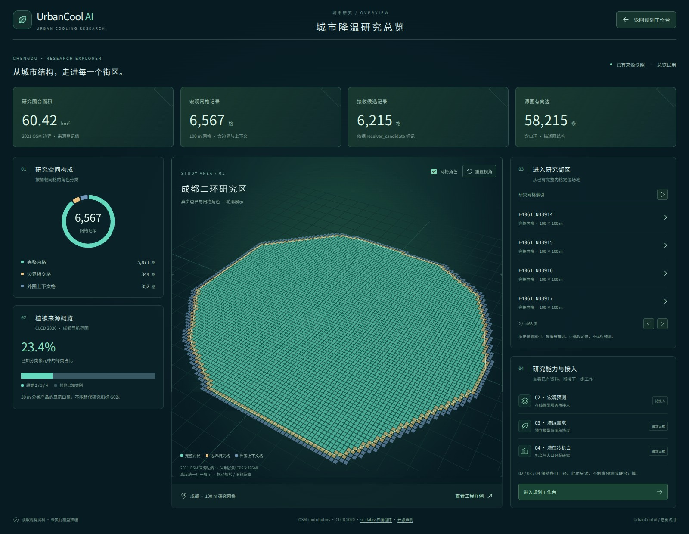
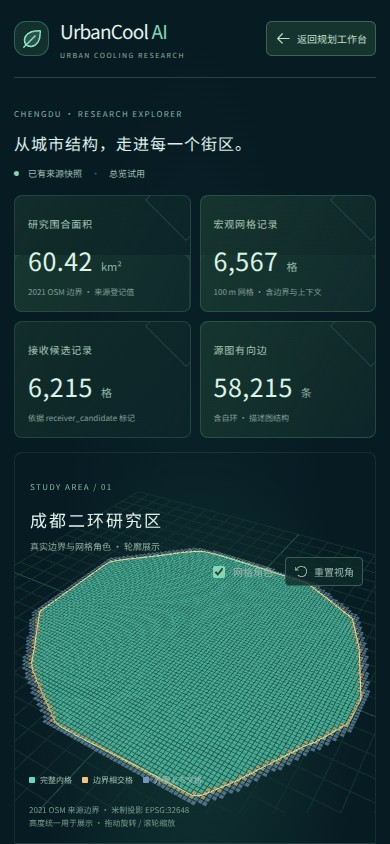

# 城市总览试用核验

基于主分支 `31b76251ae580e20098a965fdad52e6f45b82ea5`，在
`feat/urbancool-overview` 分支接入。入口为区域地图左上方的
“城市总览 · 试用”，也可在本地地址添加 `?view=overview`。

## 已完成的验证

- Node.js 24.22.1 / Linux：`npm ci`、`npm run build` 成功。
- 默认软件检查 79 项：77 通过、2 项 Mac 专用案例按定义跳过、0 失败。
- 数据下载工具的 8 项 Python 离线检查通过。
- Chromium 153：实际以 `/urban-cooling-platform-demo/` 子路径提供构建文件。
  查询参数入口、弹窗退出与重开、图表、三维画布、分页、网格显示开关、
  视角重置、键盘阅读暂停轮播、恢复轮播、减少动态效果偏好、
  网格定位回工作台和工程样例入口均已检查。
- 已检查桌面、平板和手机宽度，无横向溢出；无页面 JavaScript 异常及失败的本地资源请求。
- 数据统计另有独立检查：未知值不补零，不一致的分母不绘图，网格角色计数与
  已有资料一致，来源对象不被修改。

机器可读记录：[browser-check.json](browser-check.json)。

## 验证范围

浏览器核验阻断了外部导航底图请求；总览依赖本地研究资料。
截图环境临时加载 Noto Sans CJK SC 以显示中文，该字体未随应用提交。
软件检查与界面预览不代表模型推理、联合情景或真实降温验证。
Windows、macOS 和真实手机设备未在本轮实跑。

总览图表与三维模块按需加载，新增分块约 1.07 MB，gzip 后约 318 kB。
Vite 仍提示大分块，后续可按实际设备表现继续拆分。
